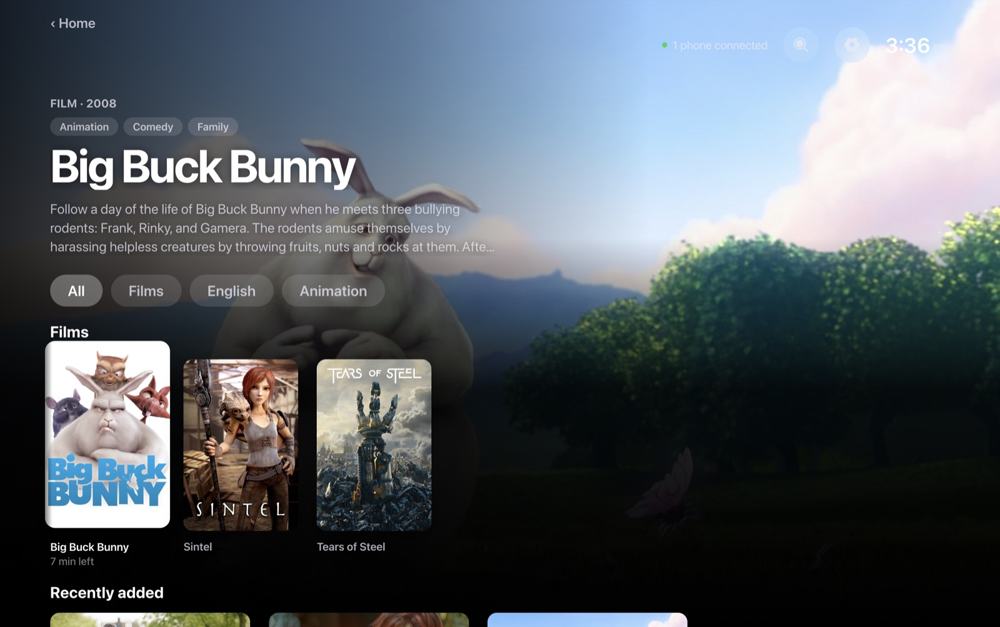
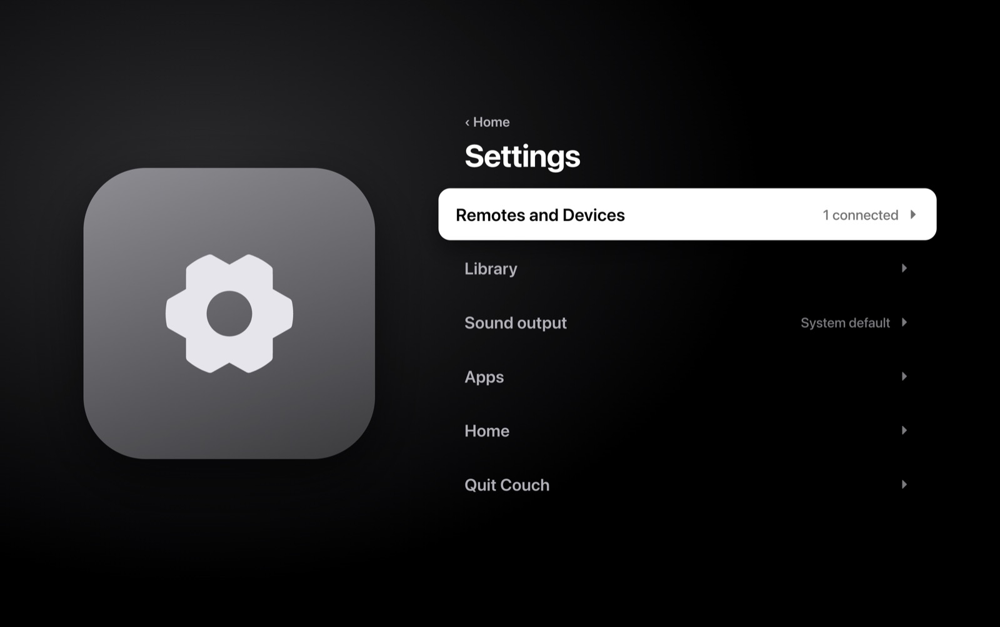
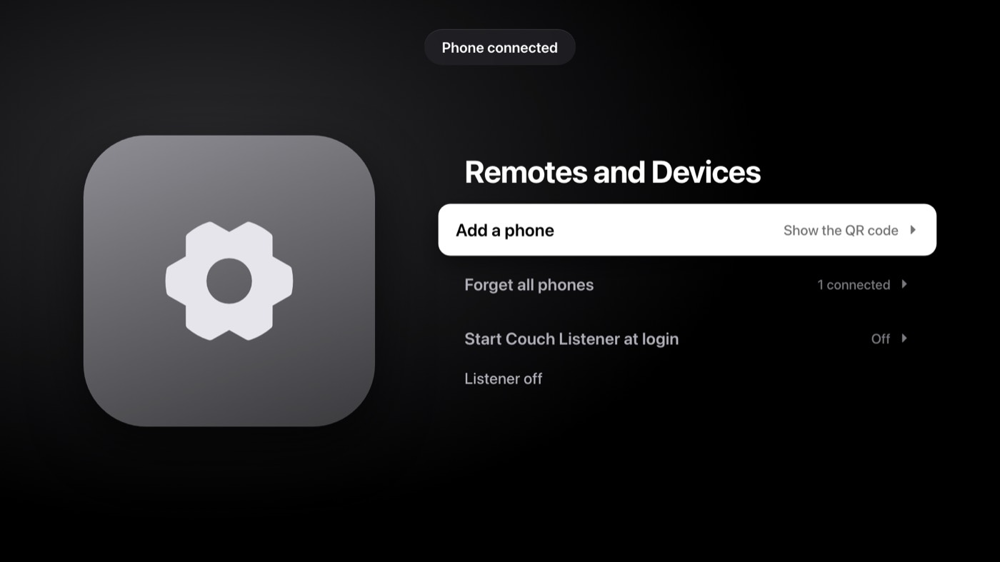
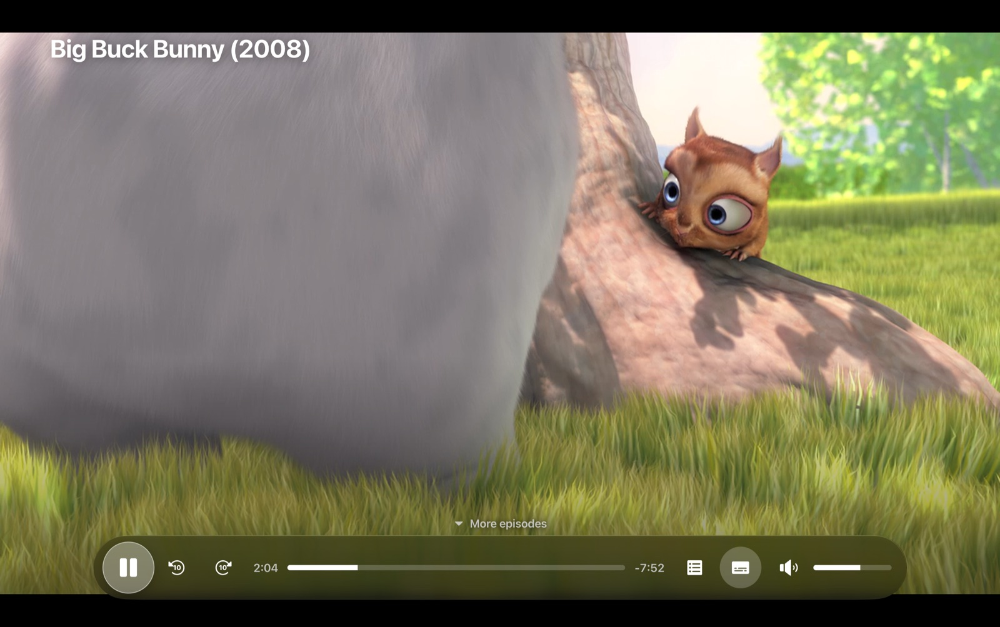

# Couch

Couch turns a Mac connected to a TV or monitor into a calm, couch-friendly home screen, and your phone is the remote. The Screen shows Home, with the Apps you open from the couch: YouTube, Netflix, and the Library of video folders on the Mac. The Remote is a web page on your phone: you scan a QR code once, and it becomes a D-pad, volume and Now Playing controls. There are no profiles and no Couch account; the household shares one Screen.

> **Early personal project.** Use your own accounts on each service. Couch shows each service's own website; it does not give access to anything you could not open in a browser.









The pictures use test videos, not real films.

Words like Screen, Remote, App and Library have fixed meanings: see [GLOSSARY.md](GLOSSARY.md). What Couch is for is in [PRODUCT.md](PRODUCT.md).

## Why I made Couch

I bought a monitor for work. A TV as well didn't make sense, so my first thought was a streaming stick, so the family could watch on the monitor in the evenings.

Then I looked at my MacBook, sitting idle every evening. Why not let it be the TV, with our phones as the remote?

So I built Couch. It brings YouTube, Netflix and our own videos to one calm home screen. I only have accounts for those, so I built Couch so that more Apps can be added. If your favourite service is missing, you're welcome to add it: see [Add a web App](CONTRIBUTING.md#add-a-web-app).

— Abdullah

## Requirements

- A Mac on macOS 14 or later.
- A TV or monitor connected to the Mac.
- A phone on the same Wi-Fi as the Mac (for the Remote).
- Nothing else to play the Library: a packaged Couch carries its own libmpv. Homebrew `mpv` is only needed to build Couch, or to run it from source.

## Build from source

Couch isn't distributed as a download yet, so you build it yourself. You need Xcode command line tools, Homebrew (with `mpv`, which `vp run package` copies into the app) and [pnpm](https://pnpm.io).

```sh
brew install mpv
pnpm install
pnpm run build:native      # builds the embedded mpv player
pnpm exec vp run start     # build and run Couch
pnpm exec vp run package   # or build out/Couch-darwin-<arch>/Couch.app
```

[CONTRIBUTING.md](CONTRIBUTING.md) has the details (tests, checks, signing for Netflix and other DRM Apps). [SHIPPING.md](SHIPPING.md) lists what it would take to ship Couch to other people.

## Commands

Tooling is [Vite+](https://viteplus.dev) (`vp`), run through pnpm.

| Command          | What it does                                                                                                |
| ---------------- | ----------------------------------------------------------------------------------------------------------- |
| `pnpm install`   | Install dependencies (Electron's download is allowed in `pnpm-workspace.yaml`)                              |
| `vp check`       | Format, lint and type-check (use `vp check --fix` to auto-fix)                                              |
| `vp test run`    | Run the Vitest tests once                                                                                   |
| `vp run build`   | Build renderer (`vp build`) and main + preload (`vp pack`) into `dist/`                                     |
| `vp run start`   | Build, then start Couch in Electron                                                                         |
| `vp run package` | Build `out/Couch-darwin-<arch>/Couch.app`, signed ad hoc by default (bundle id `com.abdullahnettoor.couch`) |
| `vp run sample`  | Generate `.dev/sample.mkv` (needs ffmpeg) for a quick playback check                                        |
| `vp run icons`   | Rebuild `build/icon.icns` and the Remote/Credits PNGs from `build/icon.png` and `icon-touch.png`            |

Run `vp` as `pnpm exec vp …` if it isn't installed globally. If `ELECTRON_RUN_AS_NODE` is set in your shell, unset it before `vp run start`.

## Layout

```
src/
  shared/      Types shared by every process: Player port, IPC channel names
  main/        Electron main process: owns the core, ports and the Remote server
    mpv/       Player port implementation: MpvPlayer: in-process libmpv core (embedded) + JSON IPC client
    display.ts Picks the external monitor, else the built-in screen
    index.ts   Wiring (window, ports, quit handling)
  preload/     contextBridge API exposed to the Screen renderer (built as CJS)
  renderer/    The Screen's UI (Vite root); draws state, forwards keys as commands
scripts/       Dev helpers
```

Build outputs: `dist/renderer` (Vite), `dist/main/index.mjs` (ESM), `dist/preload/index.cjs` (CJS, required for sandboxed preload). `vite.config.ts` holds all three configs: Vite (root `src/renderer`), `pack` (tsdown) for main and preload, and `test` (root forced to the repo).

**TMDB details (optional).** Posters and show/film details come from [TMDB](https://www.themoviedb.org). A release build can carry the project's TMDB key: put `COUCH_TMDB_TOKEN=<API Read Access Token or v3 API key>` in a git-ignored `.env` in the repo root (or set it in the environment, e.g. a CI secret) before `vp run build` / `vp run package`. It is injected into the main-process bundle only (never the renderer, the Remote page or the repo). Without it Couch behaves as bring-your-own-key: the household can paste their own key in Settings → Show and film details, or use video frames. Never commit `.env`.

## mpv hand-off

Couch loads libmpv in-process through a small native add-on (`native/mpv-embed/`, Objective-C++, N-API) and draws the video into an NSView (a `CAOpenGLLayer`) added on top of Couch's window. The video therefore moves, resizes and goes full screen with Couch, and no separate mpv window exists. The core is created idle at start with the same options as before plus `input-ipc-server`, and is still controlled only through a Unix socket in a temp folder. The view is shown on mpv's `file-loaded` and hidden on `end-file`, so Couch's UI returns when playback stops. The overlay is still mpv's `osd-overlay`. libmpv is `dlopen`ed, first from `COUCH_LIBMPV=/path/libmpv.2.dylib`, then from the copy inside the app (`Contents/Frameworks/mpv`), then from Homebrew's folders (so a source run works), so Couch still opens and shows the "needs mpv" message without it. Without the add-on (vitest) `MpvPlayer` spawns a headless mpv process instead.

**Building the add-on** (needs Xcode command line tools and `brew install mpv`, which also supplies the headers): `pnpm run build:native` writes `native/mpv-embed/mpv_embed.node` (git-ignored; run it after `pnpm install` and before `vp run start` / `vp run package`). `vp run package` unpacks it into `app.asar.unpacked`. `vp run package` also copies Homebrew's libmpv and the libraries it needs (about 50, arm64) into `Couch.app/Contents/Frameworks/mpv`, rewrites their install names to point at each other, signs them with the app's identity, and writes their licences and a manifest into `Contents/Resources` (`licenses/`, `THIRD-PARTY-LIBRARIES.md`). The built Couch.app plays without Homebrew; `pnpm bundled-mpv-check` (needs ffmpeg) proves it loads the bundled copy with Homebrew's folders unreadable and plays a small clip with an embedded subtitle track to its end.

## Checking playback by hand

Run `vp run sample` once. It needs ffmpeg and writes a 20 second test video to `.dev/sample.mkv`. Then run `vp run start`.

1. In Settings, add the `.dev` folder to the Library, then open Library and play the sample.
2. **External monitor:** with a monitor connected, Couch fills it (no menu bar, no Dock) and the video plays full screen on the same monitor. Stop the video: Couch is back in front.
3. **Built-in screen only:** unplug the monitor and repeat.
4. **Two plays in a row:** play and stop twice. Watch for Spaces animation, Dock or menu bar flashes, or Couch hiding behind another window.
5. **End of file:** let the sample play to the end. Couch returns with focus.
6. **Quit mid-play:** quit Couch while it plays. `pgrep -fl mpv` shows nothing.
7. **No mpv:** with mpv uninstalled or hidden, Couch shows "Couch needs mpv to play videos. Install it with: brew install mpv".

`pnpm webkit-selftest` runs the headless WebKit checks (it needs the native add-on built). `COUCH_LIBMPV=/path/libmpv.2.dylib` points Couch at a different libmpv.

## Setting up Couch on your Mac

You need a Mac with Homebrew, an Android phone with Chrome, and a TV or monitor on the Mac. (The Remote is a web page, so other phones may work too, but Android with Chrome is what Couch is tested on.)

1. **Install mpv.** Open Terminal and run `brew install mpv`.
2. **Build Couch.** In the Couch folder run `pnpm install`, then `pnpm exec vp run package`. This makes `out/Couch-darwin-arm64/Couch.app` (the folder name says `x64` on an Intel Mac).
3. **Install it.** Drag `Couch.app` into Applications. Open Applications, then drag Couch to the Dock to keep it there.
4. **First launch.** A local build is signed ad hoc by default (or with your own certificate, if you set `COUCH_CODESIGN_IDENTITY`; see [CONTRIBUTING.md](CONTRIBUTING.md)). It is not notarised, so macOS may block the first double-click. If it does, right-click Couch, choose **Open**, then **Open** again; what you see can differ between Macs. After that it normally opens from the Dock. Couch fills the TV; if no TV is connected it uses the Mac's screen.
5. **Pair a phone.** Join the phone to the same Wi-Fi as the Mac. Open Couch's Settings and scan the QR code with the phone. In Chrome, tap ⋮ then **Add to Home screen**. The Remote is now an icon on the phone.
6. **Sign in to YouTube.** Open YouTube in Couch. It shows a code; on the phone go to youtube.com/activate, enter the code and pick your account. You only do this once.
7. **Add Library folders.** In Settings, choose Library folders and pick the folders that hold your videos. They appear under Library.
8. **Closed-lid use.** To use the Mac with the lid shut, plug in the charger and an external monitor (the TV), and plug in or pair a keyboard/mouse if macOS asks. Without both connected, the Mac sleeps when the lid closes.
9. **"Can't reach Couch" on the phone.** Check that Couch is open on the Mac, that the Mac is awake, and that the phone is on the same Wi-Fi as the Mac (not mobile data or a guest network). Then reopen the Remote. If the Mac's network changed, open Settings on the Mac and scan the QR code again.

If Couch says it needs mpv, mpv isn't installed. Run `brew install mpv`. Couch looks for it in Homebrew's folders first, then your `PATH`, so Dock launches work.

### Run Couch from the couch

The Couch Listener is a tiny background program inside `Couch.app`. It lets the phone turn Couch on and off while the Mac is on but Couch is closed.

- **Turn it on.** Open `Couch.app` from Applications (not from the build folder), go to Settings and switch **Start Couch Listener at login** On. Settings then says "Listener running · Couch will stay reachable". In development the item is greyed out ("Available in the installed Couch.app").
- **The Power button.** On the phone's Remote, Power starts Couch when it is off, and quits it (saving your place) when it is on.
- **Sleep.** The Mac stays awake while the display sleeps, so the Remote keeps working with the TV off. It doesn't wake a Mac that is asleep.
- **"Can't reach Couch".** With the listener on, this now means the Mac itself is asleep, off or on another network. If Couch is simply closed, the phone shows "Couch is off" with a Power button.
- **Remove it.** Switch the item Off in Settings. Or run `launchctl bootout gui/$(id -u)/com.abdullahnettoor.couch.listener` and delete `~/Library/LaunchAgents/com.abdullahnettoor.couch.listener.plist`. Its log is `~/Library/Logs/Couch/listener.log`.

### Where Couch keeps its data

Settings, the pairing key, watch history, App sign-ins and thumbnails live in `~/Library/Application Support/Couch`. Rebuilding or replacing `Couch.app` keeps all of it. Delete that folder to start from scratch.

## Third-party

- **mpv / libmpv** plays the Library. It is GPL software. A packaged Couch bundles libmpv and the libraries it needs (FFmpeg, libass, libplacebo and others, copied from Homebrew when packaging); their licences and source locations are in `Couch.app/Contents/Resources/THIRD-PARTY-LIBRARIES.md` and `licenses/`. A source run loads Homebrew's libmpv instead.
- **Electron** (the castLabs ECS build) runs the Screen. Electron and castLabs ECS are MIT-licensed.
- **Widevine CDM** is downloaded at run time by the castLabs build. Couch does not ship it.
- **TMDB** supplies posters and film details. This product uses TMDB and the TMDB APIs but is not endorsed, certified, or otherwise approved by TMDB.
- The YouTube ad-blocker add-on is adapted from [VacuumTube](https://github.com/shy1132/VacuumTube) (MIT, see the top of `src/main/apps/youtube/addons/adblock.ts`). It is off by default.
- Netflix and YouTube names and logos are trademarks of their owners, used only to label those Apps. Couch is not affiliated with or endorsed by either.

## Licence

Couch is free software under GPL-3.0-or-later; see [LICENSE](LICENSE).
